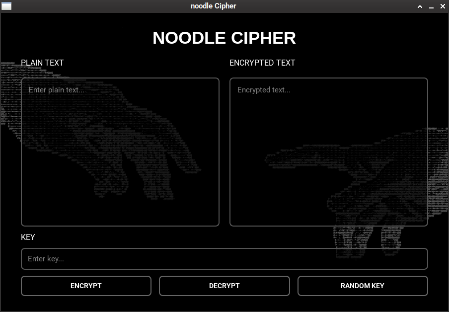

# Noodle Cipher

<p align="center">
  <b>A simple Vigenère cipher, with PyQt6 GUI.</b>
</p>

<p align="center">
  Encrypt. Decrypt. 
</p>

---

## ✦ Overview

**Noodle Cipher** is a lightweight desktop application that uses the classic Vigenère cipher, with a dark-themed graphical interface.

Built with Python and PyQt6, it lets you encrypt and decrypt text using custom keys, generate random keys, and experiment with one of the most iconic classical encryption algorithms.

## ✧ Features

- **Encrypt & Decrypt** — Easily switch between plaintext and encrypted text.
- **Custom Keys** — Use your own encryption keys.
- **Random Key Generator** — Generate random 16-character keys instantly.
- **Dark UI** — Minimal interface with a custom background image.
- **Case Preservation** — Keeps uppercase and lowercase letters intact.
- **Character Preservation** — Spaces, punctuation, and numbers remain unchanged.
- **Lightweight** — Simple Python application with minimal dependencies.

## 🖥️ Preview

<p align="center">
  
</p>

## ⚙️ Installation

### Requirements

- Python 3.10+
- PyQt6

### Setup

Clone the repository:

```bash
git clone https://github.com/heR00Tuz3r/noodle-cipher.git
cd noodle-cipher
```

Install dependencies:

```bash
pip install PyQt6
```

Run the application:

```bash
python main.py
```

## 🔑 Usage

1. Enter your plaintext in the **PLAIN TEXT** field.
2. Enter an encryption key in the **KEY** field.
3. Click **ENCRYPT** to generate encrypted text.
4. To decrypt, paste the encrypted text into **ENCRYPTED TEXT**.
5. Click **DECRYPT** to recover the original message.
6. Use **RANDOM KEY** to generate a random 16-character key.

## 🧠 The Cipher

Noodle Cipher uses the **Vigenère cipher**, a classical polyalphabetic substitution cipher.

Each letter is shifted according to a repeating keyword.

For example:

| Plaintext | HELLO |
|---|---|
| Key | KEY |
| Ciphertext | RIJVS |

## ⚠️ Disclaimer

The Vigenère cipher is **not secure by modern cryptographic standards**.

This project is intended for educational purposes, experimentation, and learning about classical cryptography.

Do not use it to protect sensitive information.

## 🛠️ Built With

- [Python](https://www.python.org/)
- [PyQt6](https://www.riverbankcomputing.com/software/pyqt/)

## 📜 License

This project is open-source. Add a license of your choice, such as the MIT License.

---
